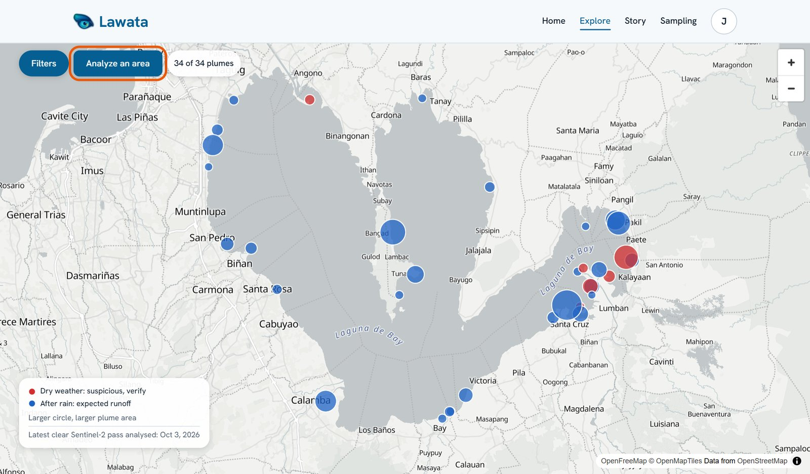
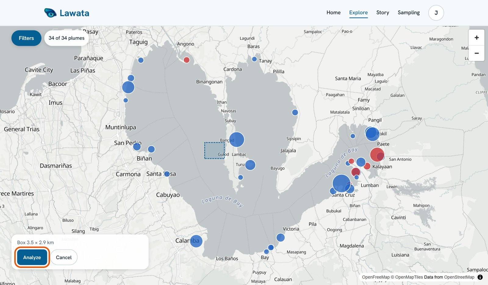
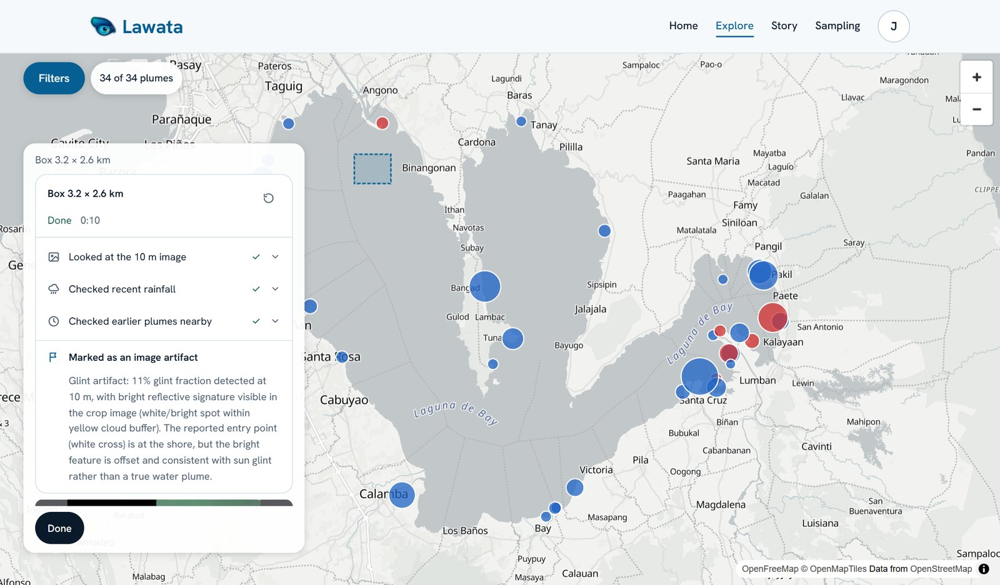
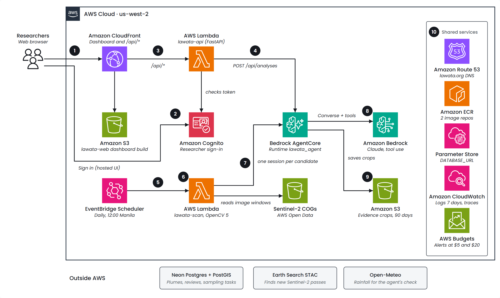
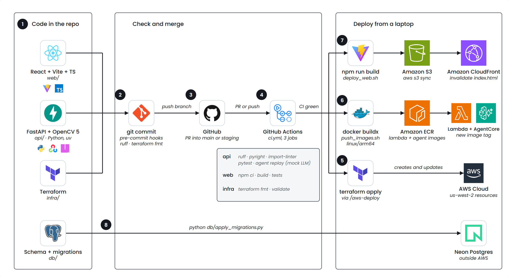

# Lawata

**An eye on our waters, from space.** Lawata watches Laguna de Bay with Sentinel-2. OpenCV 5 finds possible discharge plumes, and an agent on Amazon Bedrock AgentCore takes a closer look before anyone goes out on the lake. For each plume it makes one of four decisions: discard it, log it as expected, recheck it on the next pass, or propose field sampling. A person must approve every sampling task.

| | |
|---|---|
| Live site | https://www.lawata.org |
| Devpost | https://devpost.com/software/lawata |
| Demo video | https://youtu.be/z885TWQQFKw |

Built for the OpenCV 5 x AWS competition (Agentic Vision path). Team JPMC: JP Curada and Mai Zaragoza.

The dashboard is public. The researcher area (agent decisions, reviews, live area analysis and sampling approvals) needs an invite-only Amazon Cognito account.

## What it does
| Decision | Tool | When |
|---|---|---|
| Discard | `mark_artifact` | Not a plume: a cloud edge, haze or sun glint |
| Log as expected | `log_expected` | A real plume, but heavy rain in the days before explains it |
| Recheck | `schedule_recheck` | Too uncertain, or clouds hide the water |
| Propose sampling | `create_sampling_task` | Persists in dry weather at a spot with a history of unusual water; waits for a person |

Lawata never calls a finding "illegal". It says *suspicious, verify*: a satellite sees water colour, not PFAS or metals.

## Analyze an area
Signed-in researchers can run the agent live on any part of the lake.

**1. On the Explore map, click Analyze an area.**



**2. Drag a box on the water (each side under 5 km), then click Analyze.**



**3. Watch each tool call, then the decision.** The agent picks the newest Sentinel-2 pass with little cloud over the box, re-measures it at 10 m with OpenCV 5, checks rain and history, and explains its decision from what it saw. This real run took 10 seconds and discarded the spot as sun glint:



## Architecture

### Runtime
<picture>
  <source media="(prefers-color-scheme: dark)" srcset="web/src/assets/architecture/arch-runtime.png">
  
</picture>

- **Web and API:** CloudFront serves the React build from S3 and forwards `/api/*` to the `lawata-api` Lambda (FastAPI, arm64 container).
- **Agent:** Bedrock AgentCore Runtime runs the tool loop with Amazon Bedrock (Claude Haiku 4.5, Converse API). Its tools run in the same process: `inspect_plume` (OpenCV 5 at 10 m, crop shown to the model), `get_rainfall` (Open-Meteo) and `get_history` (PostGIS).
- **Vision:** OpenCV 5 reads only the needed windows of Sentinel-2 Cloud-Optimized GeoTIFFs on AWS Open Data: MNDWI water mask, cloud buffer, colour distance from normal lake water, contours.
- **Data:** Neon Postgres + PostGIS for plumes, decisions, reviews and sampling tasks; S3 for evidence crops; SSM for the database URL.
- **Sign-in:** Amazon Cognito, invite-only `researchers` group, code + PKCE.

### Delivery
<picture>
  <source media="(prefers-color-scheme: dark)" srcset="web/src/assets/architecture/arch-delivery.png">
  
</picture>

CI gates every change, including a replay of the three demo cases against the agent. Deploys are scripted, and a person runs them.

## Repo layout
| Folder | What | Tooling |
|---|---|---|
| `api/` | Python backend: imagery, detection, weather, sightings, sampling, agent and API. Feature-based, domain-driven | uv, ruff, pyright, pytest, import-linter |
| `web/` | Dashboard (Vite + React + TypeScript), unit and Playwright e2e tests | npm |
| `infra/` | All AWS resources as code | Terraform (AWS provider 6.x) |
| `scripts/` | `push_images.sh`, `deploy_web.sh` | bash, Docker, AWS CLI |
| `db/` | `schema.sql`, `migrations/` + `apply_migrations.py`, `migrate_sqlite_to_postgres.py`, `seed/lawata.db` (real Laguna data 2024 to 2026) | psycopg |
| `notebooks/` | 01 detection, 02 lake-wide story, 03 persist to Drive (Colab) | Jupyter |

## Prerequisites
Python 3.12, [uv](https://docs.astral.sh/uv/), Node 22, Terraform 1.9+, Docker (with buildx), AWS CLI v2, jq and Git. Dependencies are pinned in `api/uv.lock`, `web/package-lock.json` and `infra/.terraform.lock.hcl`.

## 1. First-time local setup
```bash
git clone https://github.com/JpCurada/project-lawata.git && cd project-lawata
# create .env with DATABASE_URL (never commit it)

cd api
uv sync                                  # installs the pinned versions from uv.lock
uv run pytest                            # no network; Neon tests skip without DATABASE_URL
uv run python -m lawata.agent.replay --case all --mock-llm
uv run pre-commit install                # fast hooks only: ruff, terraform fmt
cd ..

cd web && npm ci && cd ..                # package-lock.json is included
```
Expected replay output:
```
artifact: mark_artifact
rain: log_expected
dry: create_sampling_task
```

### Run locally
```bash
# terminal 1
cd api && uv run uvicorn lawata.api.app:app --reload     # http://localhost:8000/api/health
# terminal 2
cd web && npm run dev                                    # http://localhost:5173, /api proxied to :8000
```

### Researcher sign-in locally
No Cognito is needed for local work. Run the API with `AUTH_DISABLED=true` and the web with `VITE_AUTH_MODE=dev`; every request then acts as the researcher `dev`. In dev mode, Sign out and Sign in switch between the public and researcher views. The API refuses `AUTH_DISABLED` inside Lambda.
```bash
cd api && AUTH_DISABLED=true uv run uvicorn lawata.api.app:app --reload
cd web && VITE_AUTH_MODE=dev npm run dev
```

### Tests
```bash
cd api && uv run pytest -q && uv run ruff check . && uv run pyright && uv run lint-imports
cd web && npm run build && npx vitest run
cd web && npm run e2e        # Playwright; needs a throwaway local PostGIS on port 55432
```

## 2. Database (Neon)
1. Create a project at console.neon.tech in region **AWS US West (Oregon)**.
2. Put the connection string in `.env` as `DATABASE_URL`.
3. Load the schema and seed data (from `api/` so it uses the project venv):
   ```bash
   cd api
   export $(grep -v '^#' ../.env | xargs)        # PowerShell: $env:DATABASE_URL="..."
   uv run python ../db/migrate_sqlite_to_postgres.py ../db/seed/lawata.db
   ```
   The script enables PostGIS, creates the tables, copies every row in one transaction and checks row counts. To reload, add `--reset`.
   Then apply the numbered migrations (each runs once and is recorded in `schema_migrations`):
   ```bash
   uv run python ../db/apply_migrations.py
   ```
4. Check in the Neon SQL editor. This should return 6 rows:
   ```sql
   SELECT acquired_date, place, area_ha, rain_7d_mm FROM v_dry_weather_plumes ORDER BY acquired_date;
   ```

## 3. AWS account prep (once)
1. `aws configure --profile lawata` with region `us-west-2`, then `export AWS_PROFILE=lawata`.
2. In Bedrock **Model access** (us-west-2), enable a Claude model. Copy its inference profile ID (starts with `us.`).
3. Store the Neon URL in SSM. It is never put in Terraform or its state:
   ```bash
   aws ssm put-parameter --name /lawata/database_url --type SecureString --value "$DATABASE_URL"
   ```
4. Configure Terraform:
   ```bash
   cp infra/terraform.tfvars.example infra/terraform.tfvars   # set bedrock_model_id, alert_email, cognito_domain_prefix
   terraform -chdir=infra init
   ```
   State is local by default. For team use, enable the S3 backend block in `infra/versions.tf`.

## 4. Deploy
```bash
# first time only: create the image repositories
terraform -chdir=infra apply -target=aws_ecr_repository.lambda -target=aws_ecr_repository.agent

./scripts/push_images.sh v1                     # build and push both ARM64 images
terraform -chdir=infra plan  -var image_tag=v1  # review
terraform -chdir=infra apply -var image_tag=v1  # AgentCore, Lambdas, Scheduler, S3, CloudFront, budget
# first time only: point the Cognito callback URLs at CloudFront, then apply again
#   in terraform.tfvars: web_domain = "<terraform -chdir=infra output -raw cloudfront_domain>"
terraform -chdir=infra apply -var image_tag=v1
./scripts/deploy_web.sh                         # build web/ with the Cognito settings, upload behind CloudFront

curl "$(terraform -chdir=infra output -raw web_url)/api/health"
```
For later releases, push a new tag and apply with it. Use `terraform -chdir=infra output` to see the web URL, API URL and agent runtime ARN.

The first deploy needs two applies: the Cognito callback URLs need the CloudFront domain, while CloudFront depends on the API Lambda, which needs the Cognito client ID.

Invite a researcher with `aws cognito-idp admin-create-user` (their email) and `admin-add-user-to-group --group-name researchers`. Their username is shown on reviews and approvals.

To tear everything down: `terraform -chdir=infra destroy`. The Neon project and the SSM parameter are separate and stay.

## 5. Safety and cost guardrails (built in)
- The agent loop is capped at 6 turns, 8 tool calls and 20k tokens. Any limit, model error or repeated call ends in `schedule_recheck`, never in sampling.
- Every decision needs its evidence: no artifact without `inspect_plume`, no expected without rain, no sampling without rain and history. With less than 10% clear water, only a recheck is accepted.
- Sampling tasks always stop at `pending_approval`. Approving or rejecting needs a signed-in researcher, a note and a confirmation.
- Nothing runs while idle: no EC2, NAT, VPC or RDS. Neon free tier sleeps.
- At most 10 candidates per scan. AgentCore sessions end after 60 s idle and 5 min max.
- Logs are kept 7 days, and crops are deleted after 90 days.
- AWS Budget emails at $5 and $20 per month. Expected cost is about $1 to $4 per month, mostly Bedrock tokens.

## 6. Branches and CI
- Work on a feature branch, open a PR into `staging`, then promote `staging` to `main` with another PR.
- Commits stay fast: pre-commit runs only ruff and `terraform fmt`.
- CI (`.github/workflows/ci.yml`) runs on PRs into `main` or `staging` and on pushes to them: ruff, pyright, import boundaries, pytest, the agent replay, the web build (with type check) and web tests, and `terraform validate`.
- Commit messages follow `type(scope): description`, for example `feat(sampling): ...` or `chore(infra): ...`.

## 7. Status
Done:
- Detection validated on 980 Sentinel-2 scenes (January 2024 to October 2026) in the notebooks; 34 plumes in the seed data.
- Agent with real tools (OpenCV 10 m inspection, Open-Meteo rainfall, plume and watch-zone history), guards in code, and replay of the three demo cases.
- API: stats, plumes, places, reviews, sampling tasks with human approve/reject, and live area analysis.
- Web: Home, Explore (with Analyze an area), Stories, plume detail, Sampling, How it's built, and legal pages.
- Deployed on AWS at https://www.lawata.org.

Next:
1. The daily scan handler: the schedule is deployed, but the whole-lake scan still runs from the notebooks.
2. Follow up rechecks on the next clear pass.
3. Store each live area analysis so it can open a sampling task, still pending approval.

## Rules for everyone
- Python follows PEP 8, snake_case, DRY, KISS, SOLID, and the layers domain -> service -> adapters -> api (checked by import-linter).
- Never call a finding "illegal". Use "suspicious, verify". Satellites cannot see PFAS.
- Secrets live only in `.env`, `terraform.tfvars` (both gitignored) or SSM.
- Sampling tasks always stop at `pending_approval`; only a signed-in researcher approves them.
